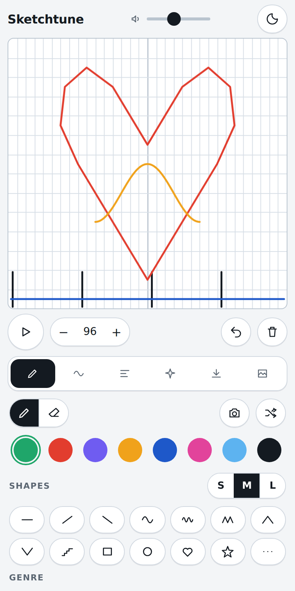

# Sketchtune

**Draw a picture, hear it play.**

Sketchtune turns any drawing into music. A playhead sweeps across your sketch and every line it crosses becomes a note: height is pitch, colour is the instrument, and the gaps are the rhythm. Draw a mug, a heart, a mountain range, your dog, and listen to what it sounds like in lo-fi, techno, or acoustic.

**Try it:** https://sheryjohn.github.io/sketchtune/

(docs/screenshot.png)

No install, no account, no backend to run. 

## What you can do

- **Draw freehand** with eight colours, each a different instrument, or stamp ready-made shapes (waves, stairs, hearts, stars, beat ticks) in three sizes that snap to the grid.
- **Pick a genre** and the same drawing is re-voiced: Pop, Acoustic, Punk, Techno, House, Dubstep, Hip hop, Lo-fi, Ambient, 8-bit.
- **Shape the sound** with key, octave, scale (major, minor, pentatonic, dorian), swing, reverb, delay, and chord mode (triad, power, 7th). Pads and drones sustain across long strokes; plucks and drums retrigger.
- **Trace a photo**: point your phone camera at a doodle or an object and Sketchtune finds the lines, colours them from the photo, and plays them.
- **Starter sketches**: ten built-in patterns, from a steady groove to gloomy minor pieces, to learn from or remix.
- **Share by link**: the whole sketch is packed into the URL, so anyone can open and hear it.
- **Export** the loop as WAV, or record a portrait video with the playhead sweeping your drawing, ready for Reels or TikTok.
- **Gallery**: publish sketches, browse newest or most liked, play them in place, like them, and remix them with credit to the original. A daily drawing prompt rotates automatically.
- **AI co-composer, bring your own model**: ask for "a gentle bassline under this" or "make it sadder" and the model draws new strokes. Works with Anthropic, OpenAI, Gemini, or any OpenAI-compatible endpoint (Ollama, LM Studio, Groq, OpenRouter). Your key stays in your browser; requests go straight to your provider.

## How the music works

The canvas is a grid of steps (8, 16 or 32 per bar, 1 to 4 bars) by 14 pitch rows. Rows snap to the chosen scale, so nothing you draw is ever out of key. Counting from the bottom: row 1 is the root, row 3 the third, row 5 the fifth, row 8 the root an octave up. Long notes on those rows always sound settled; the rows in between are passing notes.

A few drawing habits that sound good in any genre:

- Short vertical ticks in black at the bottom every four columns give you a kick on every beat.
- One flat line low down in blue is a bass note. Move it to a different row at the bar line for a progression.
- A smooth wave across the upper rows is a melody that rises and falls naturally.
- Leave empty columns. Silence is what makes the rest feel rhythmic.

All sounds are synthesised in the browser with the Web Audio API: oscillators, filters, a plucked-string model for the acoustic guitars, noise bursts for drums, a generated reverb and a tempo-synced delay. There are no samples to download.

## Run it yourself

Download `index.html` and open it, or host it anywhere static files are served (GitHub Pages, Netlify, Vercel, an S3 bucket). There is no build step and no dependency beyond a Google Font that falls back to your system font when offline.

### Gallery setup (optional)

The gallery uses a free [Supabase](https://supabase.com) project as its only backend.

1. Create a project. In the SQL editor, run `supabase.sql` once. It creates the `sketches` table, locks it so visitors can read and publish but never edit or delete, and adds two functions so like and play counts can only move up by one.
2. In Project Settings, API Keys, copy the Project URL and the publishable (anon) key.
3. Paste them into the two constants near the top of the script in `index.html`: `GALLERY_URL` and `GALLERY_ANON_KEY`.

Leave the constants empty and the Gallery tab simply says it is not connected. Moderation is done in the Supabase table editor: delete a row to remove a sketch.

### AI co-composer setup (for users)

Open the AI tab, choose a provider, paste a key, press Test, then Save. Nothing is sent anywhere except to the provider you chose. For a local model with Ollama, set the base URL to `http://localhost:11434/v1` and start Ollama with `OLLAMA_ORIGINS` set to the site's origin so the browser is allowed to call it.

## Keyboard shortcuts

| Key | Action |
| --- | --- |
| Space | Play / pause |
| P | Pencil |
| E | Eraser |
| S | Shape tool |
| Ctrl/Cmd + Z | Undo |

## Credits

Inspired by the "draw to play" sequencer concept and built as an open, hackable single file. Shapes, sounds and code are original.

## License

MIT. Draw something loud.
